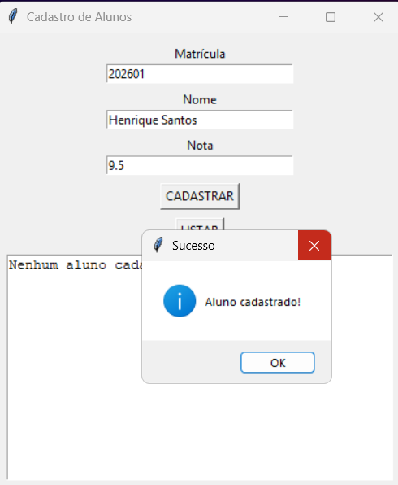
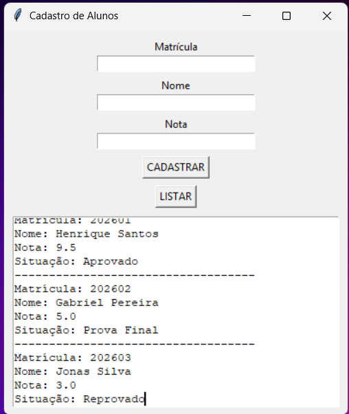

# Cadastro de alunos com Python e Tkinter

Programa de cadastro feito com interface gráfica, classes e objetos. Cada aluno tem matrícula, nome e nota; a situação é calculada automaticamente.

## Capturas da execução

### Tela inicial


### Cadastro realizado


### Listagem dos alunos


## Como executar

Com Python 3 instalado e Tkinter disponível:

```bash
python cadastro_alunos.py
```
