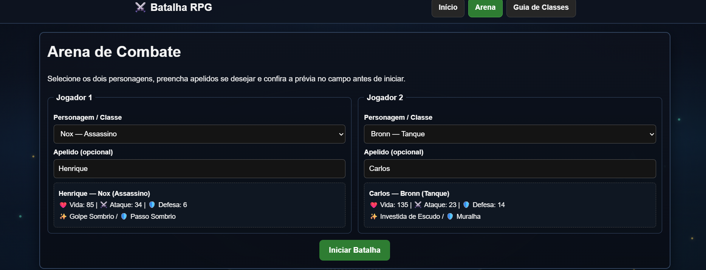
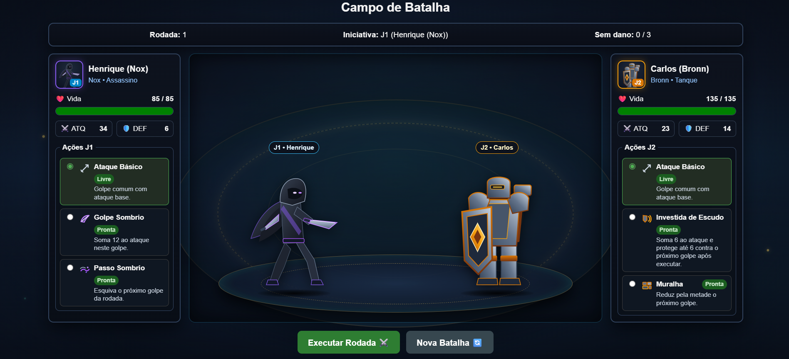
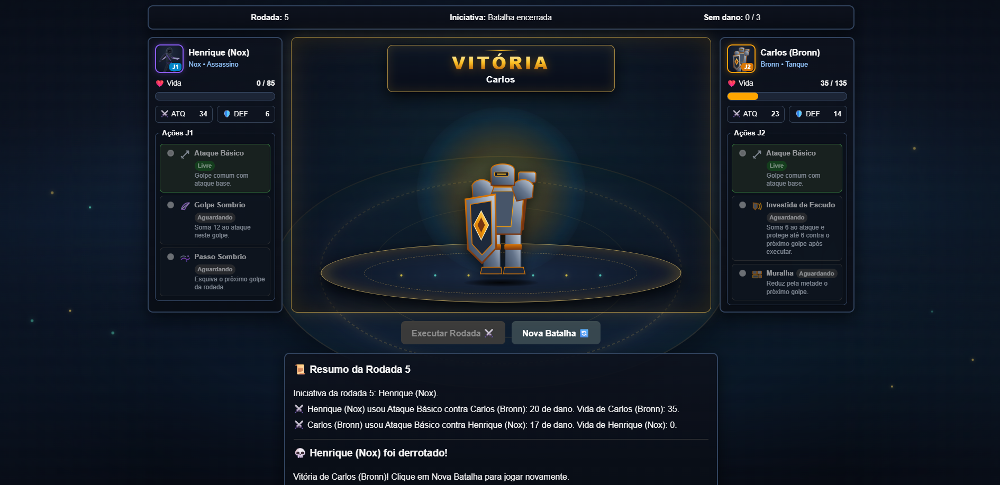
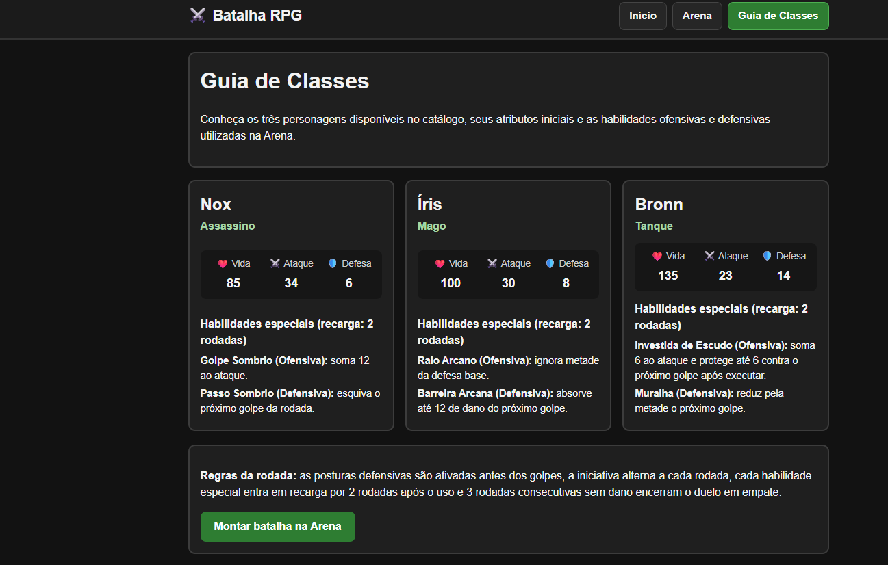

# ⚔️ Batalha RPG

Projeto acadêmico de desenvolvimento web criado por **José Henrique Sarro dos Santos** e **Carlos Henrique Pereira Miranda**.

## 1. Integrantes

- José Henrique Sarro dos Santos
- Carlos Henrique Pereira Miranda

O link do repositório será enviado ao professor no campo indicado para essa finalidade.

## 2. Tema e objetivo do site

O tema escolhido foi um jogo de batalha RPG por turnos para dois jogadores no mesmo navegador. O site permite escolher personagens, consultar seus atributos e habilidades e disputar uma batalha em uma arena visual.

O jogo conta com três personagens:

| Personagem | Classe | Vida | Ataque | Defesa | Habilidade ofensiva | Habilidade defensiva |
| --- | --- | ---: | ---: | ---: | --- | --- |
| **Nox** | Assassino | 85 | 34 | 6 | **Golpe Sombrio**, que soma 12 ao ataque. | **Passo Sombrio**, que esquiva o próximo golpe da rodada. |
| **Íris** | Mago | 100 | 30 | 8 | **Raio Arcano**, que considera metade da defesa base do alvo. | **Barreira Arcana**, que absorve até 12 pontos de dano. |
| **Bronn** | Tanque | 135 | 23 | 14 | **Investida de Escudo**, que soma 6 ao ataque e concede proteção contra o golpe seguinte. | **Muralha**, que reduz pela metade o dano recebido. |

A iniciativa alterna entre os jogadores. Cada habilidade especial possui recarga, e a partida termina com a derrota de um personagem ou com empate após três rodadas consecutivas sem dano.

## 3. Uso das tecnologias

### HTML5

Foi usado para estruturar as páginas **Início**, **Arena** e **Guia de Classes**, organizar o menu de navegação, os formulários de seleção dos jogadores, os painéis de atributos, os controles da partida e os resumos das rodadas. Foram utilizados elementos semânticos para separar as áreas principais do conteúdo.

### CSS3

Foi usado para definir cores, tipografia, organização dos painéis e aparência da arena. Também foi responsável pelo layout responsivo, pelas barras de vida, pelos estados visuais dos controles e pelas animações dos personagens e efeitos de habilidades.

### JavaScript

Foi usado para controlar a seleção dos personagens, atualizar atributos e apelidos na página, calcular os ataques e as defesas, alternar a iniciativa, controlar as recargas e verificar vitória ou empate. O JavaScript também atualiza o registro da partida e aciona efeitos visuais conforme as ações realizadas.

## 4. Como o grupo desenvolveu o trabalho

José Henrique e Carlos desenvolveram o projeto em conjunto. Trabalhamos nas mesmas partes e discutimos as decisões de estrutura, regras, personagens e funcionamento da arena para que os dois compreendessem o conceito geral do jogo.

Durante o desenvolvimento, acompanhamos as alterações, revisamos o funcionamento das páginas e ajustamos juntos a lógica e a apresentação do combate. A colaboração nas mesmas etapas ajudou a manter o projeto coerente e permitiu que ambos participassem das decisões e do aprendizado.

## 5. Capturas de tela do site funcionando

As capturas abaixo mostram a seleção dos personagens, o combate na arena, o resultado da partida e o guia de classes. Os arquivos estão na pasta `img/screenshots/`.

### Seleção de personagens

Os jogadores escolhem seus personagens, informam apelidos opcionais e consultam os atributos e as habilidades antes de iniciar a batalha.



### Campo de batalha

A arena mostra os personagens, a iniciativa da rodada, os status dos jogadores e as ações disponíveis.



### Resultado da partida

O vencedor aparece centralizado na arena, com o letreiro de vitória e o resumo da rodada final.



### Guia de Classes

O guia apresenta os atributos e as habilidades de Nox, Íris e Bronn.



## 6. Dificuldades e aprendizados

A parte mais trabalhosa foi criar as animações das ações e habilidades usando JavaScript. Foi necessário sincronizar os efeitos visuais com a lógica de cada rodada, respeitar a iniciativa, mostrar ataques e defesas no momento correto e encerrar os efeitos sem interferir no estado da partida.

Com essa etapa, aprendemos a relacionar a lógica do JavaScript com as mudanças visuais da página, controlar estados do combate, atualizar elementos do HTML e aplicar classes de estilo para representar as ações dos personagens. Também praticamos a integração entre HTML, CSS e JavaScript em uma aplicação interativa.

## Como executar

1. Abra a pasta `Projeto-gb` no Visual Studio Code.
2. Abra `index.html` com a extensão Live Server ou diretamente em um navegador moderno.
3. Acesse a Arena pelo menu, selecione os personagens e inicie a partida.

## Estrutura do projeto

```text
Projeto-gb/
├── .vscode/
│   └── settings.json
├── img/
│   ├── personagens/
│   │   ├── nox-corpo.svg
│   │   ├── iris-corpo.svg
│   │   └── bronn-corpo.svg
│   └── screenshots/
│       ├── selecao-arena.jpg.png
│       ├── campo-batalha.jpg.png
│       ├── tela-vitoria.jpg.png
│       └── guia-classes.png
├── index.html
├── arena.html
├── classes.html
├── style.css
├── script.js
└── README.MD
```